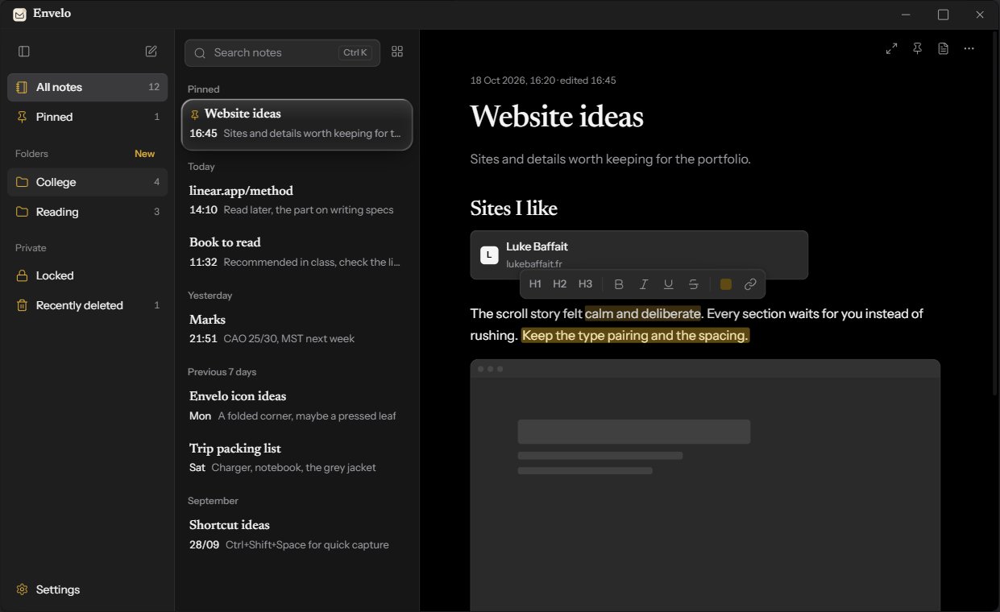
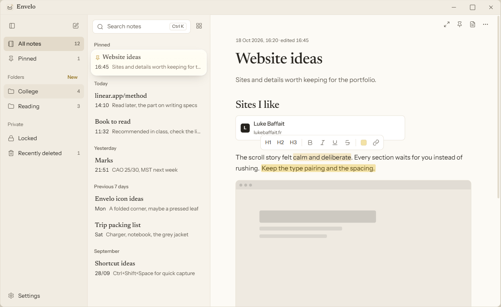
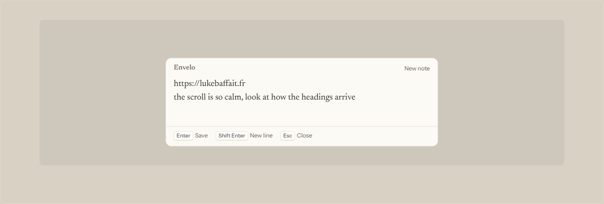

<p align="center">
  
</p>

<h1 align="center">Envelo</h1>

<p align="center">
  A quiet, fast notes app for Windows. Thoughts, links and screenshots, kept as plain files on your laptop.
</p>

<p align="center">
  
  <br>
  <sub>Design preview with sample notes</sub>
</p>

---

## What it does

Envelo is one place to drop anything: a passing thought, a link, a screenshot, or a proper
formatted note. It opens straight onto your last note, works fully offline, and stores every note
as an ordinary Markdown file you can open in any editor.

- **Quick capture from anywhere.** Press `Ctrl+Shift+Space` in any app, type, press Enter. The box
  folds away and the note is saved.
- **Writes like a modern editor.** Headings, bold, italic, underline, highlight, lists, checklists,
  quotes, tables and dividers. Type `/` for a block menu, or use Markdown shortcuts like `##`.
- **Pictures and links.** Paste or drag in screenshots. Paste a link on its own line and it becomes
  a card with the page's title.
- **Smart typography.** Straight quotes turn curly, `->` becomes an arrow, `...` becomes an ellipsis.
- **Search, pins and folders.** Keyword search as you type, pinned notes at the top, real folders
  on disk, and notes grouped by date.
- **Recently deleted.** Deleted notes wait 30 days and can be restored into the folder they came from.
- **Locked folder.** Encrypted notes that open with a password, or with a security question if
  you forget it.
- **Light and dark mode**, four accent colours, and a choice of how the open note is highlighted
  (liquid glass, contour lines, or nothing).
- **Lives in the tray.** Closing the window keeps Envelo ready, and it can start with Windows so
  quick capture always works.

<p align="center">
  
  
  <br>
  <sub>Light mode, and the quick capture box (<code>Ctrl+Shift+Space</code>)</sub>
</p>

## Install

Build the installer (see [Build from source](#build-from-source)), then run
`Envelo_0.1.0_x64-setup.exe` (about 2 MB). It installs for your user
account only, so no administrator prompt. Envelo then appears in the Start menu and in Windows'
Installed apps.

Runs on Windows 10 and 11. It uses Windows' WebView2 runtime, which Windows 11 already has; the
installer fetches it if it's missing.

## Shortcuts

| Keys | Action |
|---|---|
| `Ctrl+Shift+Space` | Quick capture, from any app |
| `Ctrl+N` | New note |
| `Ctrl+K` | Search |
| `Ctrl+1` / `2` / `3` | Heading 1 / 2 / 3 |
| `Ctrl+0` | Body text |
| `Ctrl+B` / `I` / `U` | Bold / italic / underline |
| `Ctrl+.` | Focus mode |
| `Ctrl+\` | Show or hide the sidebar |
| `/` | Block menu (headings, lists, table, picture...) |
| `Delete` in the list | Move the note to Recently deleted |

## Your notes

Everything lives in `Documents\Envelo`:

```
Documents\Envelo\
  Website ideas.md        a note (its file name follows its title)
  College\                a folder you made in Envelo
  images\                 pictures pasted into notes
  .trash\                 Recently deleted (kept 30 days)
  .locked\                the encrypted locked folder
```

Each note is Markdown with a short header for its dates and pin:

```markdown
---
created: 2026-10-18T16:20:00+05:30
modified: 2026-10-18T16:45:00+05:30
pinned: true
---
Website ideas

Sites and details worth keeping.
```

Because they're plain files, backing up is just copying the folder, and OneDrive or any other sync
tool works without setup. Nothing is sent anywhere. The only network request Envelo makes is
fetching a page title when you paste a link.

## The locked folder

- One random key encrypts every locked note with **AES-256-GCM**.
- That key is stored twice, each copy protected by **Argon2id** (64 MiB, 3 passes): once from your
  password and once from your security answer. Either one unlocks.
- Locked notes are stored under random file names, so even titles stay hidden.
- Five wrong tries in a row means a one minute wait. The folder locks again after 5 idle minutes and
  whenever Envelo closes.
- If you use the security answer, you must choose a new password before the notes appear.

Good to know:

- If you forget **both** the password and the answer, locked notes can't be recovered. That's what
  makes the encryption real.
- Pictures can't go into locked notes, because pictures are stored as ordinary files.
- A note that was moved into the locked folder may still exist in older OneDrive versions or file
  recovery tools from before it was locked. Notes written in the locked folder from the start never
  touch the disk unencrypted.

## Speed

Measured on the development laptop with the release build: launch to a visible, usable window in
about 0.8 seconds (median of 6 runs). Opening from the tray is instant. The app is 5 MB; the
installer is 2 MB.

## Build from source

You'll need [Node.js](https://nodejs.org), [Rust](https://rustup.rs) and the
[Microsoft C++ Build Tools](https://visualstudio.microsoft.com/visual-cpp-build-tools/)
("Desktop development with C++").

```bash
npm install
npm run tauri dev      # run with live reload
npm run tauri build    # make the installer
```

The installer is written to `src-tauri/target/release/bundle/nsis/`.

Run the Rust tests (storage, front matter and locked folder encryption):

```bash
cd src-tauri
cargo test
```

`npm run dev` opens the interface in a plain browser with notes kept in the browser, which is
handy for checking layout. Folders, the locked folder and pictures need the real app. In dev
builds, setting `ENVELO_NOTES_DIR` points Envelo at a scratch folder so tests never touch real notes.

## How it's built

| Part | What it uses |
|---|---|
| App shell | [Tauri 2](https://tauri.app) on Windows' built-in WebView2 |
| Interface | [Svelte 5](https://svelte.dev) and plain CSS |
| Editor | [TipTap](https://tiptap.dev) (ProseMirror), saving to Markdown |
| Files, folders, encryption, tray | Rust (`src-tauri/src`) |
| Fonts | Newsreader and Instrument Sans, bundled |

```
src/
  App.svelte              main window: sidebar, list, editor
  Capture.svelte          the quick-capture box
  lib/
    Editor.svelte         TipTap editor, format bar, / menu, pictures
    extensions.js         link cards, pictures, / menu, trailing line
    notes.svelte.js       notes, autosave, search, folders, trash
    vault.svelte.js       locked folder state
    Locked.svelte         set up, unlock and forgot-password screens
    Settings.svelte
src-tauri/src/
  lib.rs                  note files, folders, trash, tray, shortcut, startup
  vault.rs                locked folder encryption
design/
  mockup.html             the approved design, open it in a browser
```

The full feature list and the decisions behind it are in [SPEC.md](SPEC.md).
